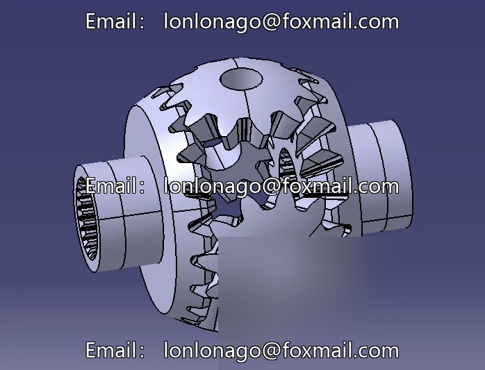
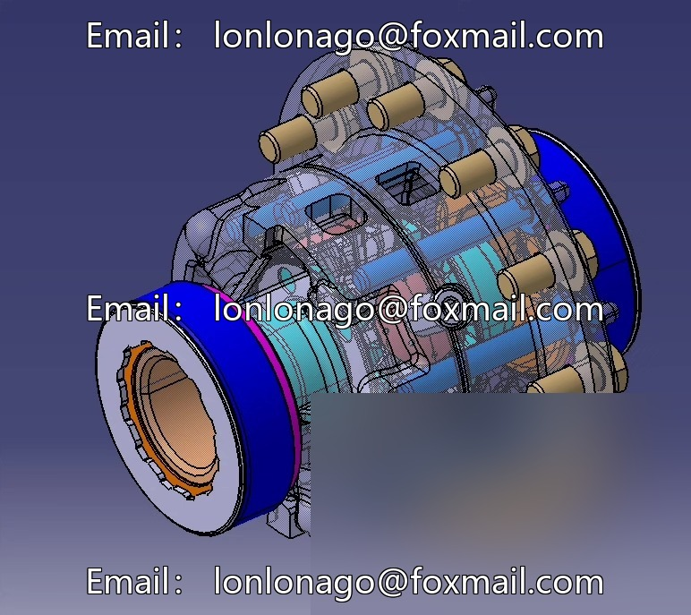
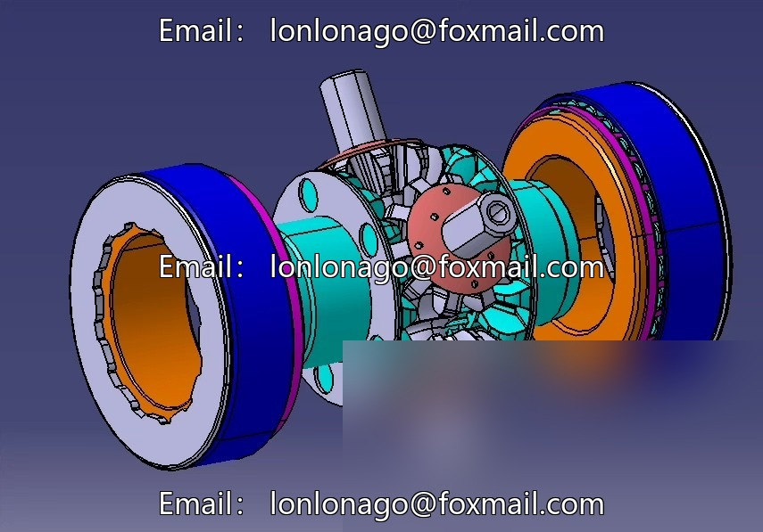
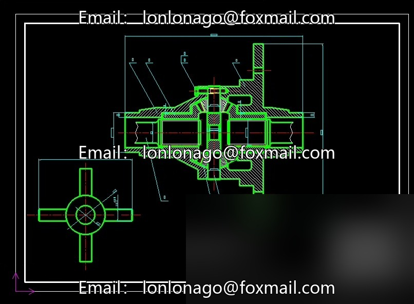

# 3D modeling differential gear design drawing

## Body

3DModeling differential gear design drawings; differential gear design; differential gear; differential gear; figure differential gear; differential gear data and simulation; differential gear three-dimensional3D Differential vehicle diagram; differential2D
Can use Catia UG, SolidWorks, and others to open and edit
A017 There are also various other 3D drawings of various types; specific details to be discussed further.
Other design instructions, if necessary additional ones will be provided.

The design drawings cover 3D modeling differential gear design, including two-dimensional and three-dimensional differential gear figures, and are editable via CATIA, UG and SolidWorks.

<!-- AI_ENRICHED -->

## Images

## Payment

Here is a pay link on Stripe ( https://buy.stripe.com/3cs8yP7sY87d0vu9AB ). Please contact me lonlonago@foxmail.com after funding $89, and I will send you a complete data files , thank you!

